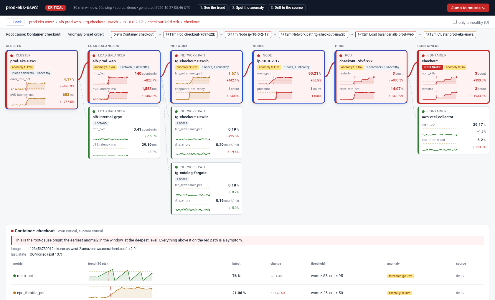
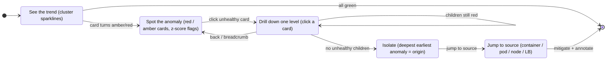
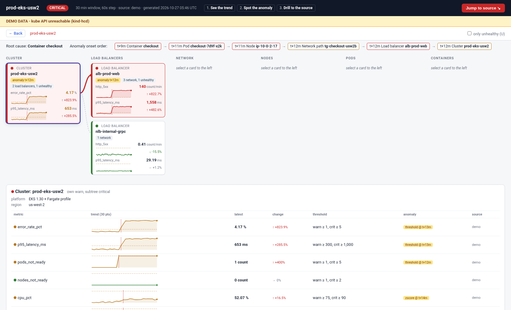

# opsKit dashboard: cluster-to-container triage flow

An interactive dashboard for **on-call SREs** running Kubernetes on **EKS (EC2 and Fargate)**,
**ECS Fargate**, or a local **kind** cluster. Instead of a wall of graphs it follows the way you
triage at 3 a.m.: **see the trend → spot the anomaly → drill to the source**.



*Demo incident: the red path runs Cluster → ALB → target group → node → pod → container. The
`checkout` container (OOMKilled from t+9m) is marked **ROOT CAUSE**. Everything above it on the
path is a symptom.*

## The six levels

Each level is a column of health-colored cards. Clicking a card opens its children in the next
column. Every metric shows a sparkline, the latest value, and the % change between the earlier
and later halves of the window. A metric is flagged when it crosses its warn line, or when it
holds a z-score ≥ 3 for 3+ points (with a ≥ 10% shift) against the start of the window.

| # | Level | Metrics (warn / critical) | Data sources |
|---|-------|---------------------------|--------------|
| 1 | **Cluster** | error_rate_pct 1/5 %, p95_latency_ms 300/1000, pods_not_ready 1/5, nodes_not_ready 1/2, cpu_pct 75/90, mem_pct 80/90 | kube API (readiness), metrics.k8s.io (sum of node usage vs allocatable), Prometheus/AMP, Container Insights `cluster_*` |
| 2 | **Load balancers** | http_5xx 5/50 per min, p95_latency_ms 300/1000, unhealthy_hosts 1/2, rejected_conns 1/10 | CloudWatch `AWS/ApplicationELB` / `AWS/NetworkELB`. Live mode on a plain cluster uses one "edge" card for LoadBalancer/NodePort Services (unhealthy_hosts = their not-ready endpoints) |
| 3 | **Network** | tcp_retransmit_pct 1/3 %, dns_errors 1/10 per min, endpoints_not_ready 1/2, rx_drops 1/10 | Endpoints (kube API), CoreDNS `coredns_dns_responses_total`, VPC CNI / node-exporter metrics, target-group CloudWatch metrics |
| 4 | **Nodes** | cpu_pct 75/90, mem_pct 80/90, pressure 1/1, evictions 1/3 | metrics.k8s.io nodes, Node conditions, node-exporter, Container Insights `node_*`. Fargate "nodes" have CPU/memory only |
| 5 | **Pods** | restarts 1/3 (in window), error_rate_pct 1/5, p95_latency_ms 300/1000, cpu_pct 80/95 (of limits) | Pod status, metrics.k8s.io pods, app RED metrics via Prometheus/OTel |
| 6 | **Containers** | mem_pct 85/95 (of limit), cpu_throttle_pct 25/50, oom_kills 1/1, restarts 1/3 | containerStatuses (OOMKilled, CrashLoopBackOff), metrics.k8s.io, cAdvisor `container_*` |

Health rolls up: a card shows the worst of its own metrics and its subtree. The **root-cause
origin** is the entity with the earliest anomaly onset. Ties go to the deepest level. The header
timeline lists every anomaly in onset order, so the propagation is visible at a glance.

Thresholds live in `panels.py`. Override them per level in the JSON config under `thresholds`.

## Interaction guide

| Action | How |
|--------|-----|
| Drill down | Click a card. Its children open in the next column, connected by edges |
| Back | `← Back`, a breadcrumb, `Esc` or `Backspace`. Clicking the selected card collapses it |
| Jump to the root cause | **Jump to source ↘** or `J`. It selects the origin and draws the red path |
| Hide the healthy noise | Check "only unhealthy", or press `U` |
| Details | The panel under the graph shows big sparklines with warn lines and onset markers, thresholds, anomaly reason and source per metric |
| Share a view | The URL hash is the selection, e.g. `demo.html#ctr-checkout-7d9f-x2k-checkout` |



`--mermaid` also prints the incident itself as a state diagram, with the origin filled red. You
can paste it into a postmortem or a GitHub issue.

## Modes

Run from the repo's `src/` directory (or install opsKit and drop `PYTHONPATH`):

```bash
cd src
# 1. demo: seeded incident, no cluster or packages needed
PYTHONPATH=. python -m dashboard demo                      # terminal view
PYTHONPATH=. python -m dashboard demo --html /tmp/triage.html --mermaid
open "/tmp/triage.html#ctr-checkout-7d9f-x2k-checkout"    # or xdg-open; lands on the root cause

# 2. live: one snapshot from the cluster (text + optional HTML), exits 0 healthy / 1 unhealthy / 2 error
PYTHONPATH=. python -m dashboard live --context kind-hcd --html /tmp/live.html

# 3. serve: HTTP flow view, re-collected every --refresh seconds (0 = on every request)
PYTHONPATH=. python -m dashboard serve --host 0.0.0.0 --port 8090 --context kind-hcd --refresh 15
```

The HTML is a single self-contained file: inline SVG, vanilla JS, no CDN. You can mail it,
attach it to a ticket, or open it offline.

**serve endpoints:** `/` is the flow view (it auto-reloads every `--refresh` seconds and keeps
your selection). `/state.json` returns health, origin, path and entities. `/text` is the
terminal view and `/healthz` returns `ok`. With `--refresh N > 0` a background sampler keeps
collecting between page loads, so metrics.k8s.io sparklines (which only report "now") fill in
over time. The window is `window_minutes / refresh` points.

**Fallback:** if the kubeconfig can't be loaded, the API server doesn't answer, or no metrics
backend responds, the page still renders the demo incident under a yellow
**DEMO DATA - <reason>** banner, and the console line says so. A failed collection mid-run
does the same and re-probes on the next refresh.



## Pointing the dashboard at a cluster

Settings resolve in this order: **CLI flag > environment > `--config` JSON > default**.

| Setting | Flag | Environment | Default |
|---------|------|-------------|---------|
| kubeconfig path | `--kubeconfig` | `DASHBOARD_KUBECONFIG`, `KUBECONFIG` | `~/.kube/config` (in-cluster config when running in a pod) |
| context | `--context` | `DASHBOARD_KUBE_CONTEXT`, `KUBE_CONTEXT` | kubeconfig current-context |
| cluster label | `--cluster-name` | `DASHBOARD_CLUSTER`, `CLUSTER_NAME` | the context name |
| Prometheus URL | `--prometheus-url` | `PROMETHEUS_URL`, `DASHBOARD_PROMETHEUS_URL` | unset |
| metrics source | `--source auto\|metrics-api\|prometheus\|demo` | `DASHBOARD_SOURCE` | `auto` |
| namespaces | `--namespace` (repeatable) | | all |
| bind host / port | `--host`, `--port` | `DASHBOARD_HOST`, `DASHBOARD_PORT` | `0.0.0.0`, `8090` |
| refresh | `--refresh` | `DASHBOARD_REFRESH_SECONDS` | `15` |

With `source=auto`, the dashboard does the following:
1. It pings the kube API. Topology, readiness, restarts, OOMKills, pressure, Services and
   Endpoints always come from here.
2. If `PROMETHEUS_URL` is set and answers `vector(1)`, it uses PromQL range queries (cAdvisor,
   kube-state-metrics, node-exporter, CoreDNS) for a full window straight away.
3. Otherwise it uses metrics.k8s.io (metrics-server) for CPU/memory as % of allocatable or limits.
4. If none of these respond, it falls back to demo data with the banner.

### kind (e.g. `kind-hcd`) with metrics-server

```bash
kubectl --context kind-hcd top nodes          # verifies metrics.k8s.io works
cd src && PYTHONPATH=. python -m dashboard serve --context kind-hcd
```

### Adding the LGTM stack (Prometheus/Mimir in namespace `observability`, svc `lgtm`)

```bash
kubectl --context kind-hcd -n observability port-forward svc/lgtm 9090:9090 &   # 3000 is Grafana
PROMETHEUS_URL=http://localhost:9090 PYTHONPATH=. python -m dashboard serve --context kind-hcd
# running inside the cluster instead: PROMETHEUS_URL=http://lgtm.observability.svc:9090
```

Container memory % needs kube-state-metrics (`kube_pod_container_resource_limits`). Node
panels need node-exporter series that carry a `node` label. Queries that return nothing are
skipped and the metrics.k8s.io and status values still show.

### EKS / EKS Fargate / ECS Fargate

* **EKS:** `aws eks update-kubeconfig --name <cluster> --region <region>`, then `--context` the
  ARN it prints. Fargate pods are labeled `eks.amazonaws.com/compute-type=fargate` and show as
  Fargate nodes. Fargate has no kubelet/cAdvisor scrape or node metrics, so use Container
  Insights or an ADOT collector sidecar (the demo's `aws-otel-collector`) for container depth.
* **Amazon Managed Prometheus** requires SigV4-signed requests. Pass a signing session to
  `PrometheusCollector(url, session=...)` (e.g. `requests-aws4auth`), or front it with a SigV4 proxy.
* **ALB/NLB and ECS:** `collectors/cloudwatch.py` (`CloudWatchCollector`) reads `AWS/ApplicationELB`,
  `AWS/NetworkELB`, `ContainerInsights` and `ECS/ContainerInsights` with paginated
  `GetMetricData`. See `sample_config.json` for the load balancer refs.

### Viewing from another device (e.g. Vision Pro Safari)

`serve` binds `0.0.0.0:8090` by default. Open `http://<laptop-LAN-IP>:8090/` from any browser
on the same network. **The server has no authentication.** It exposes node, pod and namespace
names and metrics to anyone who can reach the port. Use it on a trusted network, use
`--host 127.0.0.1` together with SSH tunnelling, or put an authenticating proxy in front.

## Dependencies

* **Core and demo:** Python ≥ 3.10 standard library only.
* **live / serve against a cluster:** `kubernetes` (`pip install kubernetes`). It is imported
  lazily, and if it is missing you get the demo banner.
* **Prometheus:** `requests` (already an opsKit dependency, via `opskit.http.build_session`).
* **CloudWatch / ALB / ECS:** `boto3` (an opsKit dependency).

## Architecture

```
models.py      Level, Health, Threshold, MetricSeries, Entity, TriageResult
trends.py      trend (% change, arrow), z-score + threshold anomaly detection
panels.py      per-level metric specs, units, thresholds, sources
triage.py      evaluate tree, roll up health, find origin + path + timeline
demo.py        seeded OOMKill incident (EKS + Fargate, 6 levels)
config.py      DashboardConfig, JSON + env + CLI precedence
collectors/    k8s.py (kube API + metrics.k8s.io), prometheus.py, cloudwatch.py,
               live.py (topology -> six-level tree, rolling history, source selection + fallback)
render/        html.py (static interactive page), text.py (terminal), mermaid.py
server.py      stdlib ThreadingHTTPServer + snapshot cache
__main__.py    CLI: demo | live | serve
tests/         pytest, all cluster access mocked
```

## Tests

```bash
cd src && python -m pytest dashboard/tests -q
```

The tests cover trend and anomaly maths, origin detection, HTML node ids, config precedence,
live tree building and every fallback path (mocked kube and Prometheus), and the HTTP server on
an ephemeral port.

## Roadmap

* AMP SigV4 session helper. CloudWatch ALB cards in live mode, driven by `load_balancers` config.
* Per-pod RED metrics from OTel/Prometheus (error rate, p95) in live mode.
* Warning-event overlay on sparklines. Deploy markers from rollout history.
